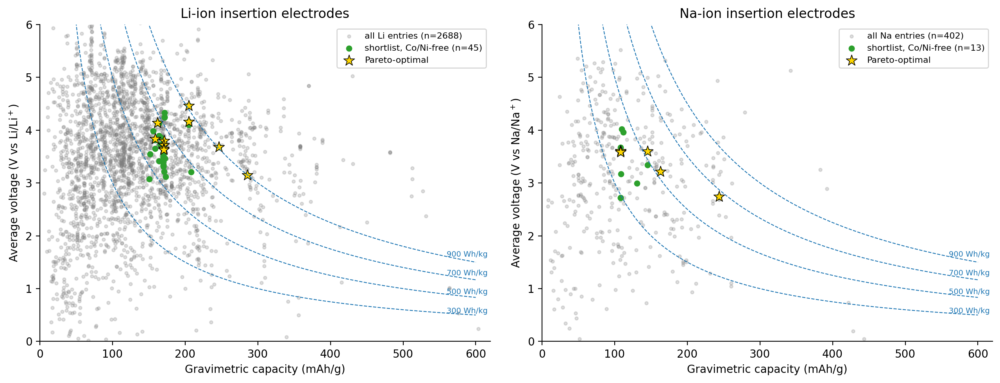
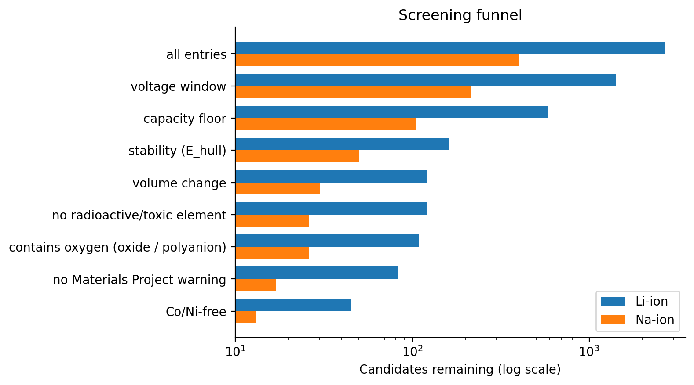

# Sustainability-aware screening of battery insertion electrodes
 

 
Screens all insertion-electrode records of the Materials Project (database version
2026.04.13, retrieved 8 October 2026; 6,847 records, 10 working ions) for practical
cathode targets. It asks how many good candidates remain without cobalt and nickel,
how sensitive the answer is to the thresholds, and what changes when lithium is
replaced by sodium. All numbers are computed (DFT) data: no new material was
discovered and nothing was tested in a laboratory.
 
## Headline results
- Li-ion: 2,688 entries -> 109 pass the voltage, capacity, stability, volume and
  oxygen filters -> 83 carry no Materials Project warning -> 45 are also Co/Ni-free
  -> 29 are free of Co, Ni and other scarce elements.
- Na-ion: 402 -> 26 -> 17 -> 13 -> 7. The lists are short, so sodium is indicative only.
- The Li shortlist (no supply filter) depends on the stability limit: 28, 83 and 186
  survivors at 0.025, 0.05 and 0.10 eV/atom.
- For 197 host formulas that occur with both ions, sodium's voltage is lower by a
  median of 0.15 V.
- A random forest predicts the DFT voltage from the formula with MAE 0.59 V on unseen
  chemical systems (0.93 V for a per-ion baseline, 1.16 V for the plain mean).
 

 
## Method
1. Download all records for ten working ions, one ion at a time (mp-api).
2. Audit and clean the data (physical limits, cleaning log).
3. Benchmark against LiFePO4 and LiCoO2.
4. Screening funnel with named assumptions, then a sensitivity analysis.
5. Pareto ranking on energy, stability and volume change.
6. Sustainability layer: a Co/Ni-free list and a stricter list without other scarce
   elements.
7. Optional: voltage prediction from the formula with grouped validation and two
   baselines.
 
## Assumptions (all adjustable at the top of the notebook)
- Li cathode: 3.0-4.5 V, at least 150 mAh/g. Na cathode: 2.5-4.2 V, at least 100 mAh/g.
- Both end states within 0.05 eV/atom of the hull; volume change at most 10 %.
- Voltage at most 7 V; oxides and polyanion compounds only; entries with a Materials
  Project warning excluded.
- Element lists: Co/Ni (Tier A), other scarce elements (Tier B), radioactive and
  toxic elements (always excluded).
 
## Repository structure
- notebooks/MP_Battery_Explorer.ipynb : the Colab notebook (run top to bottom)
- results/ : tables (CSV) and summary files (JSON)
- figures/ : the six figures (PNG)
- requirements.txt : exact package versions
 
## How to reproduce
1. Get a free API key at https://next-gen.materialsproject.org/dashboard
2. In Colab, add it as a secret named MP_API_KEY and switch on Notebook access.
3. Open the notebook with the badge above and choose Runtime, Run all.
 
## Limitations
- DFT numbers, not experiments; no kinetics, electrolyte compatibility, cost or
  synthesis.
- The top of the Co/Ni-free Li list is still led by vanadium oxyfluorides; the
  stricter lists are the better sustainability answer.
- The LiMn2O4 benchmark is inconclusive (several MnO2 polymorphs).
- thermo_type was empty in this download; the Li/Na comparison matches by formula
  only; results depend on the database version.
 
## Data, credits and licence
- Data: Materials Project (Jain et al., APL Mater. 1, 011002, 2013), CC BY 4.0 as
  stated by the Materials Project; check the current terms.
- Library: pymatgen (Ong et al., Comput. Mater. Sci. 68, 314, 2013).
- Code: MIT licence.
- Tools: say honestly here if AI assistance was used to scaffold the code, and that
  you reviewed and understand every cell.
 
## References
Aydinol et al., Phys. Rev. B 56, 1354 (1997); Ong et al., Energy Environ. Sci. 4,
3680 (2011); Joshi et al., ACS Appl. Mater. Interfaces 11, 18494 (2019); Moses et al.,
ACS Appl. Mater. Interfaces 13, 53355 (2021); Louis et al., ACS Appl. Mater.
Interfaces 14, 26587 (2022).
